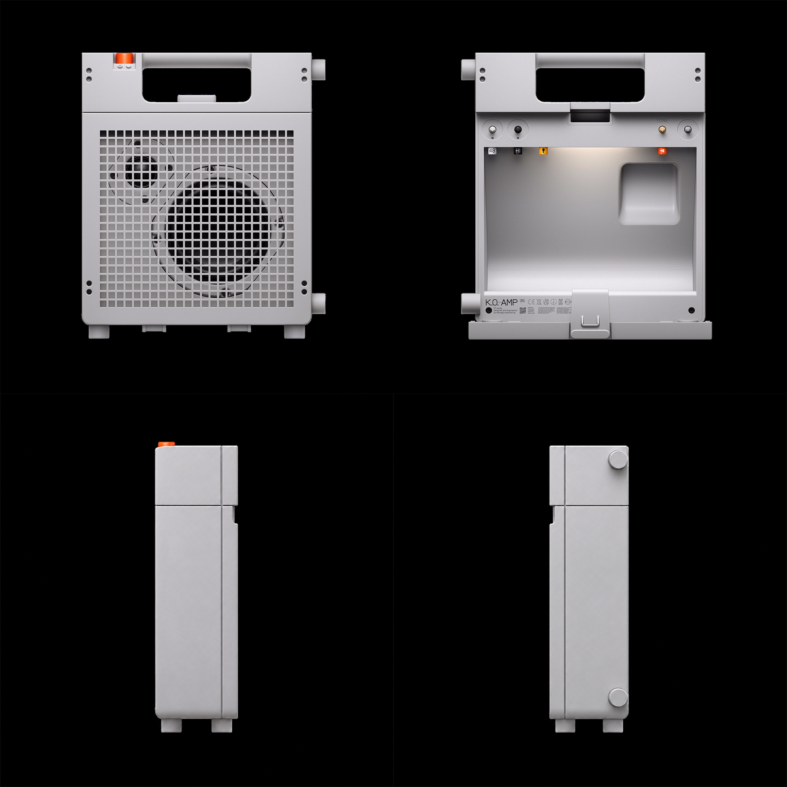
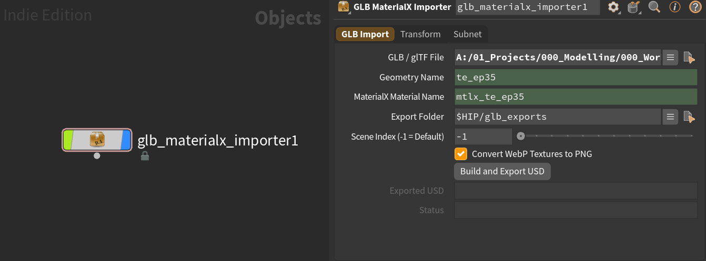
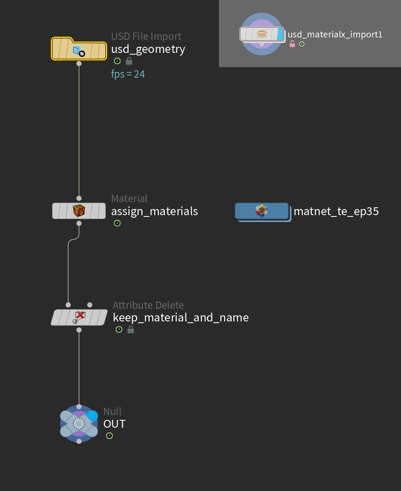

**LocalMesh Engine** is built using Microsoft Research's image to 3D model: **TRELLIS.2**. It turns one photograph, or four sides of the same subject, into a textured mesh and runs on a single NVIDIA card with at least 8 GB of memory, with no external generation service in the loop.

This could be very useful when blocking out the scene with proxy geometry and act as a placeholder for more detailed models at a later stage. The meshes could also help in the modelling process as a reference for topology and dimensions.  

## Key Features

- **Local Processing** - All computation runs completely on your machine, no cloud uploads, external server calls, or API keys required.
- **Hardware Requirement** - Designed for an NVIDIA GPU with a recommended 8 GB VRAM minimum.
- **Input Options** - Takes a single photograph or multiple angles of a subject.
- **Output Formats** - Exports quad meshes (.obj) with 4K textures and separate PBR maps.
- **Texture Projection**: Reference photo can be projected onto the object as texture. 
- **Open Source** - Engine code and details can be explored via the GitHub Repository.


## Installation  

1. Install Python 3.12.
2. Install PyTorch 2.8 + CUDA 12.8.
3. Compile three CUDA extensions: o_voxel, cumesh, and flex_gemm.
4. Obtain manual access approval for DINOv3 on Hugging Face.
5. Clone the Quentincls/localmesh-engine GitHub repository.
6. Download the required large models into the `LOCALMESH_ROOT/models` folder.

## Reference Images 

1. At least **one** image of the object is required. 
2. For a more detailed/accurate model, use **four** reference images, one for each of the four views: front, back, left and right.



<aside>
💡 In this example, I was able to find an image of the front and back and had ChatGPT create both the side views. Useful when you don't have all the views or need a perspective view converted.    
</aside> 

## Generation
As there is no GUI, we will be using a terminal (such as PowerShell) to run these commands. Make sure it's pointing to the folder where LocalMesh is located. Depending on your requirements, select the options that are relevant to you.

```shell
# one reference image
python -m localmesh_engine photo.png --to out/

# four reference images of the subject
python -m localmesh_engine face.png --right right.png --left left.png --back back.png --to out/

# a tier and a fixed seed
python -m localmesh_engine photo.png --tier high --seed 42 --to out/

# the drawn texture only, without the photographs projected onto it
python -m localmesh_engine photo.png --no-projection --to out/

# custom output name 
python -m localmesh_engine face.png --to out/ --output-name TE_EP_35

```

<aside>
💡 I asked ChatGPT to add a custom output name option that helps identify the file once done generating. This is useful when you have a lot of files in the output folder.     
</aside>

## Conversion 

The `.glb` file exported will contain both the geometry and the materials. However, it seems the viewport in Houdini, once imported in the GLTF SOP, is unable to preview the textures (as of H22.368).

The textures must be available as external image files and this can be achieved with a `gLTF Hierarchy` node which builds the scene and extracts the embedded textures. This method creates a `Principled Shader` which could work in some cases, but as we will be importing into Unreal, `MaterialX` materials would be a better choice. 

To automate this process, I asked ChatGPT to build a conversion `HDA` that: 
 
1. Imports .`glb` file
2. Converts embedded materials to `MtlX` 
3. Creates a `textures` folder with extracted images (also converts the embedded green channel roughness into a greyscale image) 
4. Exports to a `.usd` file



## Import 

A standard `.usd` import in SOPs context using `USD File Import` will need materials added to it in a separate node downstream. 

Again, to automate this process, ChatGPT created another HDA that:

1. Imports _filename_.usd with `Import / Rebuild`
2. Geo and Mtls given `name` from _filename_
3. `Material Network` created with Mtlx mats 
4. `Material` assigns materials to model 
5. `Attribute Delete` helps link correct materials for Unreal by deleting unneccessary primitive attributes 




<aside>
💡 We now have a generated model in USD format with MaterialX materials and viewport textures in both SOPs and Solaris.      
</aside>