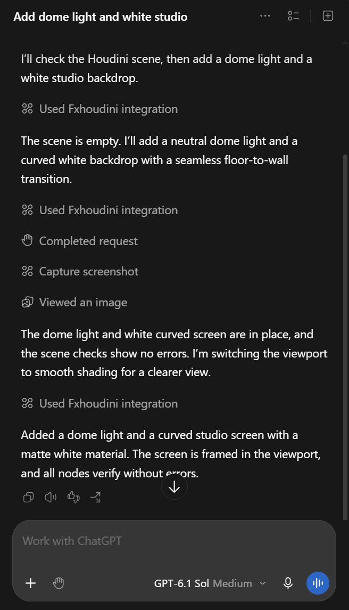
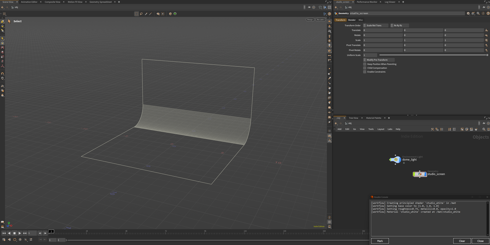

## 1 - What is it?

An open-source _MCP_ server for SideFX Houdini: it lets an AI assistant create nodes, build networks, set up simulations, inspect USD stages and render, through Houdini's own Python API. It works with any MCP client: Claude, Codex, Copilot, Gemini, Cursor, Windsurf, VS Code, Cline and others.

[💡 More info on GitHub](https://github.com/healkeiser/fxhoudinimcp)


## 2 - Installaton

```powershell
pip install fxhoudinimcp
python -m fxhoudinimcp install
```

### 2.1 - Upgrade 

```powershell 
pip install --upgrade fxhoudinimcp
```

### 2.2 - Uninstall 

```powershell 
python -m fxhoudinimcp uninstall
pip uninstall fxhoudinimcp
```

`pip uninstall` alone leaves the package file and the client entry behind, and both then fail silently. Remove them first.

## 3 - Usage 

The plugin starts with Houdini's UI (`FXHOUDINIMCP_AUTOSTART`), and the MCP menu starts, stops and checks it. MCP > Connect a Client... shows the port this session actually got (a second Houdini takes the next free port), copies the command that registers the server with every client found, and lists the manual form for each client.

Instruct it through the MCP client: 

- "`Create a model of the building using given drawings`" 
- "`Remodel structural components to more accurately resemble drawing`" 
- "`Change width of all glass panels to 5mm`" 
- "`Debug why my scene has cooking errors`" 

### 3.1 - In action 


ChatGPT screen requesting a studio backdrop with a white material and dome light


Houdini screen showing the result of the request