## 1 - Reference

To start getting to grips with modelling in Houdini, we will be modelling dice. This dice is a traditional shape: a cube with six identical square faces with each side carrying a marking made from a different number of dots, known as pips, ranging from 1 to 6. The numbers on opposite sides must always add up to seven. 

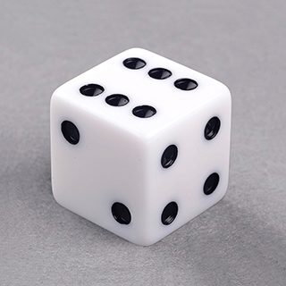
A traditional dice

## 2 - Modelling

### 2.1 - Create Box
Begin by creating a `box` primitive (polygon mesh) and increasing the `Axis Divisions` to `9`. This is very important as it sets up the spacing and layout of the dots. Essentially a value of 9 creates 7 dots within each axis that will be used to create all markings. 

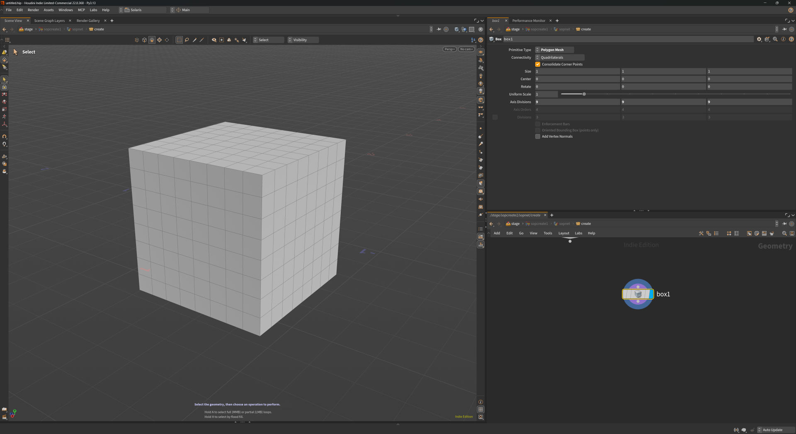
Step 01 - Create Box 

### 2.2 - Group Edges
Next, create a `Group` node and enable `Include by Edges`. Select the `Min Edge Angle` to select all cube edges. This will be helpful for the next step when we want to select edges to bevel. 

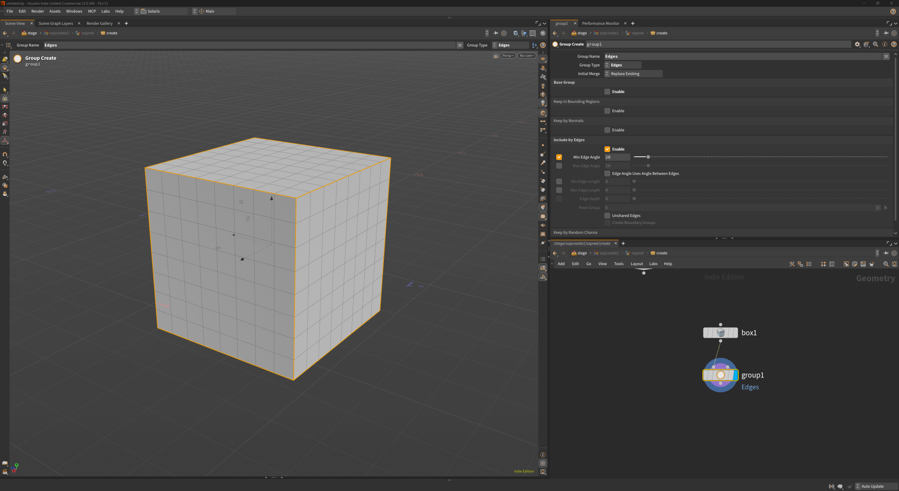
Step 02 - Group Edges

### 2.3 - Bevel Cube Edges
Create a `PolyBevel` node and add the group from the previous step, in our case, __Edges__ to the `Group` selection box. Add a `Distance` of `0.068` to create the bevel and then make sure the `Shape` is `Round` with `1` Divisions. 

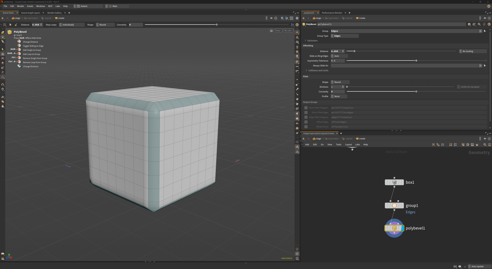
Step 03 - Bevel Cube Edges 

### 2.4 - Bevel Marking Points
Use the layout diagram below to help figure out which faces show which dots and then select the corresponding `points` to a `PolyBevel` node. Make sure `Slide on Ring Edges` is set to `Always` and set the distance to `0.1`. The `Shape` should be `Round` with divisions of `1`. This results in a square being placed for every dot, which will soon be subdivided to give a circular result. To create a selection of these new faces, enable the `Point Fillet Polygons` and rename it to **number_markings**. 

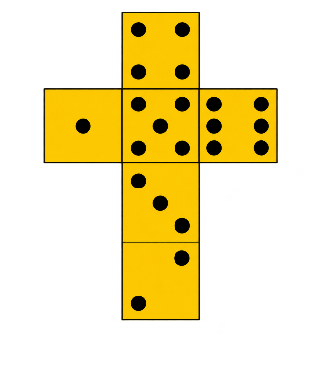
Step 04 - Dice Dot Layout

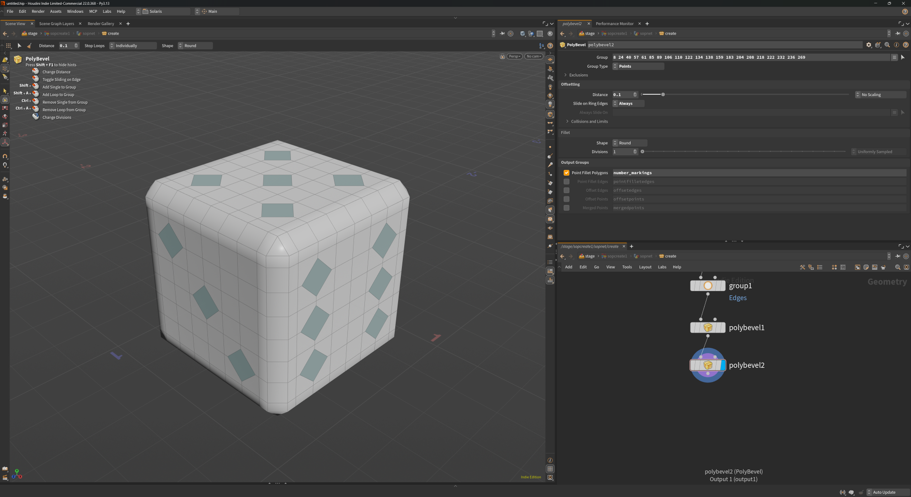
Step 04 - Bevel Marking Points 

### 2.5 - Extrude Markings 
Create a new `PolyExtrude` node and select the **number_markings** group. Set a `Distance` of **-0.035** to create some depth which, when suddivided, will create the recessed look of the markings. It is useful, at this stage, to enable the `Front and Side Groups` of the extrusion so that they can be selected when it comes to applying the materials.   

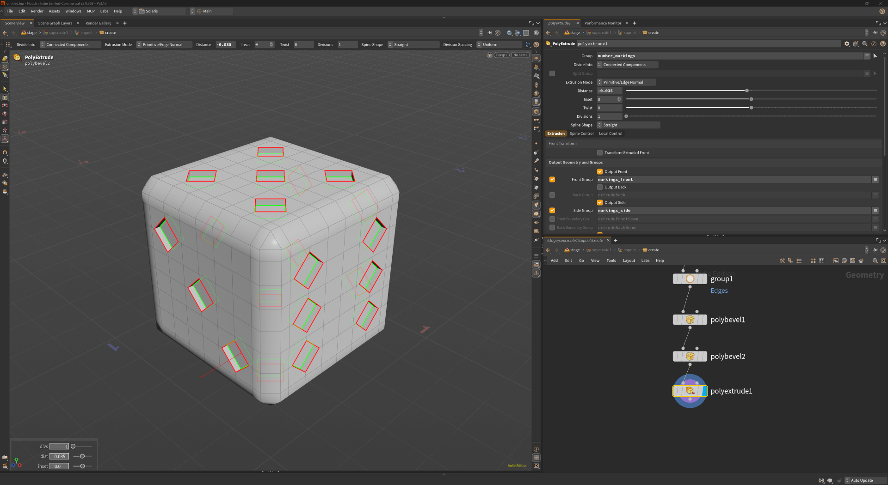
Step 05 - Extrude Markings 

### 2.6 - Inverse Group 
As we have the markings as a group now, it is also useful for us to inverse this selection and have a group for the rest of the cube, which will use a different material. To do this, we create a `Group` node and then add the Front and Side extrusion groups, in our case, **markings_front** and **markings_side** and entering into that selection, before using _ctrl + i_ to invert the selection and saving that as **cube**. 

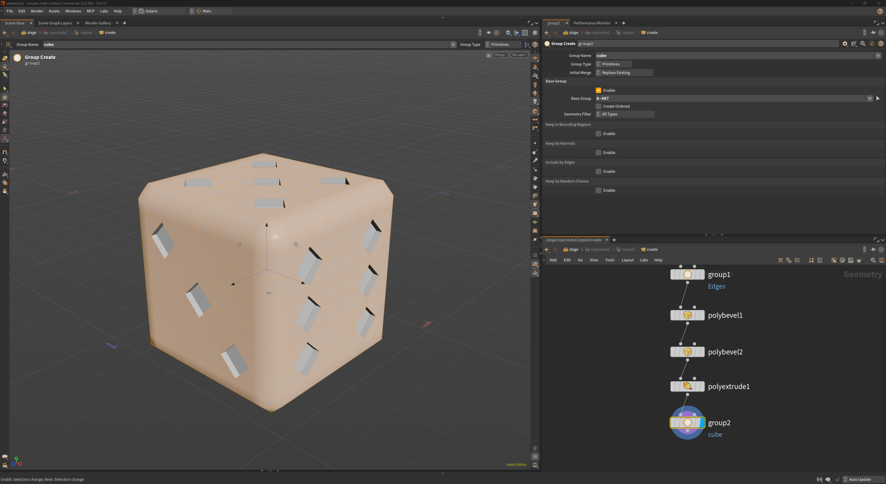
Step 06 - Inverse Group 

## 3 - Texturing

This part involves adding basic materials to the dice using our pre made groups.

### 3.1 - Basic Materials 
Create a `MTLX Standard Surface` within a `Material Network` and rename it to **mtlx_white_cube**. Set the `Color` to white and the `Diffuse Roughness` to `0.5`. Now make a copy of this material node and rename it to **mtlx_black_numbers**. Edit the colour to black. These are the only materials we will need. 

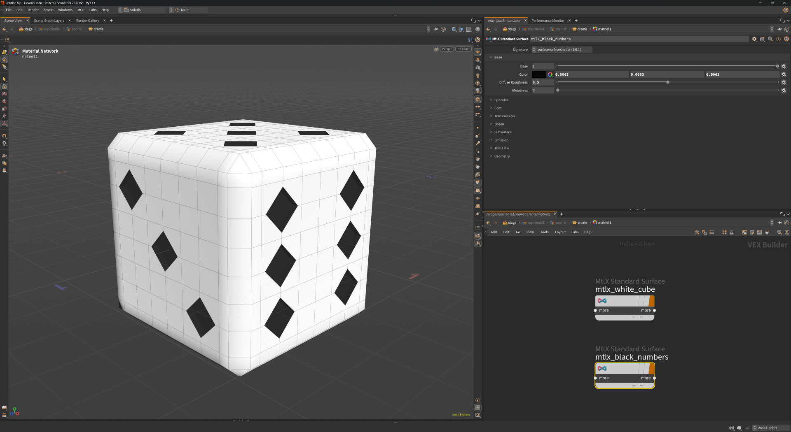
Step 07 - Basic Materials

### 3.2 - Applying Materials 
Place a `Material` node and set the `Number of Materials` to `2`. Select the **cube** group and set the `Material` to point to **mtlx_white_cube**. Do the same for the **markings_front** and **markings_side** with the **mtlx_black_numbers** material. 

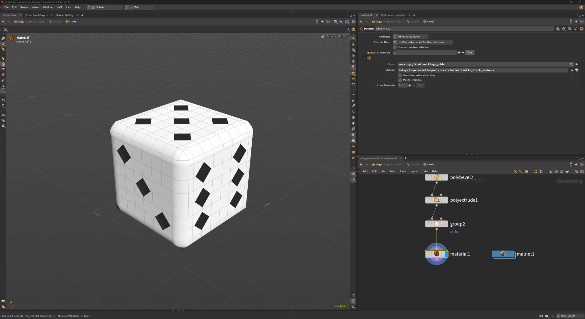
Step 08 - Applying Materials

### 3.3 - Solaris
This example was created in a `SOP Create` node within `Solaris` with the `Stage` context. If using the default `OBJ` context, you may need to use `Scene Import` to start rendering with Karma. 

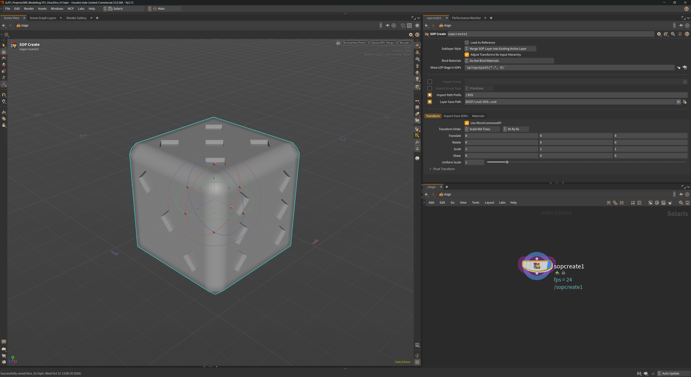
Step 09 - The geometry in Solaris

### 3.4 - Enable Subdivision
To see what the geometry looks like when subdivided we must enable the checkbox `Treat Polygons as Subdivision Surfaces` under the `Import from SOPs` tab. This essentially smoothes out the polygons and renders the result.  

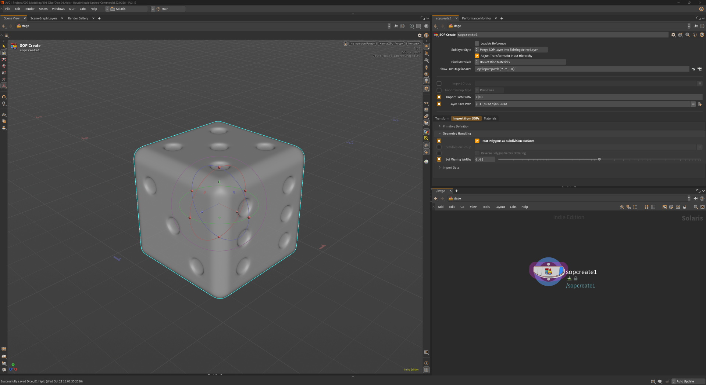
Step 10 - Enable Subdivision

### 3.5 - Auto-fill Materials
The last step is to select the `Materials` tab and click `Auto-fill Materials`. This will generate the necessary geometry and material paths that we set earlier. We now have our finished dice.   

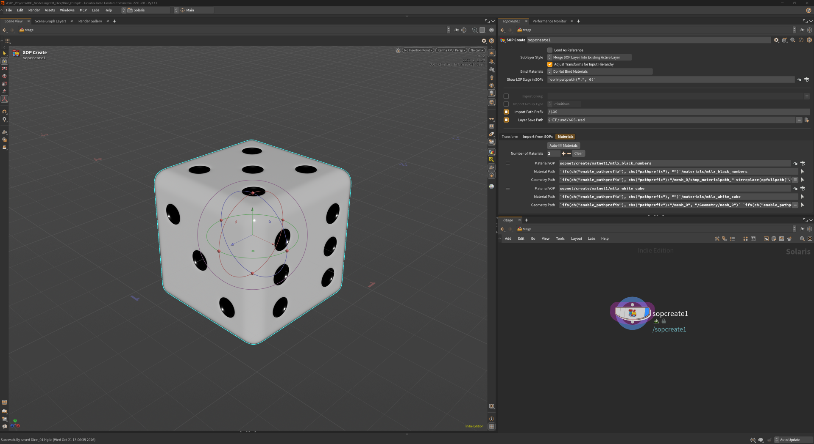
Step 11 - Auto-fill Materials 

## 4 - Renders

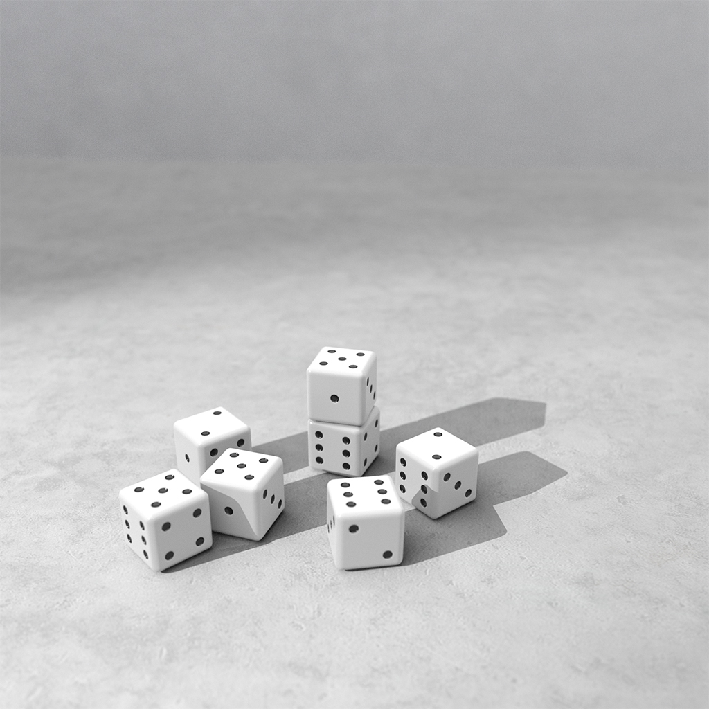
A collection of instanced dice