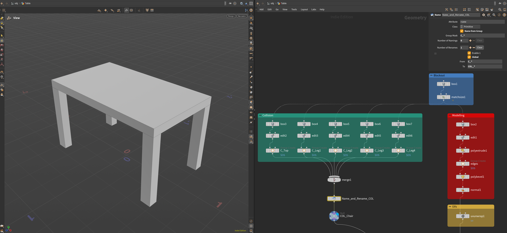
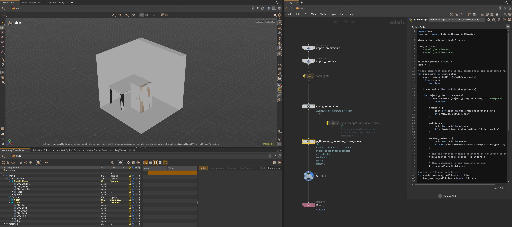
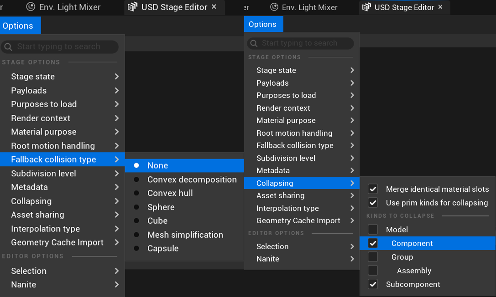
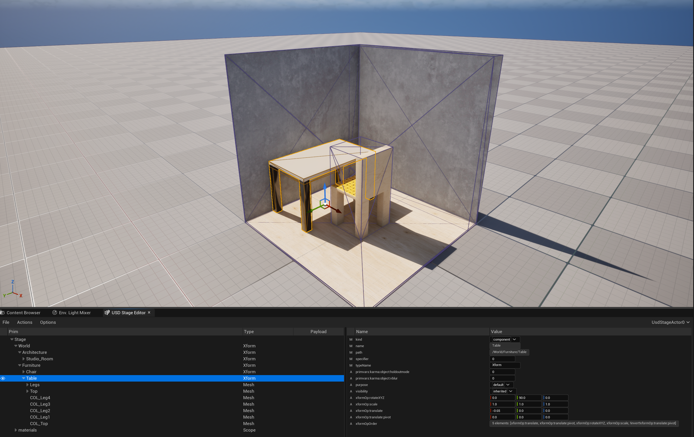

When creating architectural scenes for Unreal, collision is an important aspect to consider when you want to explore or interact with the space. It allows the player to _walk through_ a doorway or _walk up_ a staircase and helps make sure they do _not fall_ through the floor. 

In some cases, Unreal will automatically create collision  when importing files that have no collision through USD Stage and `Fallback Collision` set to something other than `None`. It is also possible to create simple collision **after** importing by selecting the individual static mesh properties. For a simple, no set-up approach, you can even set the existing polygon mesh as a complex collision.   

However, it is efficient to create custom collision in Houdini with it embedded in the file. Naming a Houdini group collision_geo_ucx alone won’t work for USD files. There must be collision meshes in the same level as the visible geometry in Solaris.  

## OBJ Context



We want to create the least amount of seperate parts as possible to achieve the intended function of the collision. The parts must also be simple shapes as they will be invisible (and take up less memory). 

In our case, the **Table** model being used has gaps between its legs and a solid top. If using the _blockout_ object as is, this would create a box collision around the whole table. Nothing would be able to go through the legs. Which is why in this case, we would use 4 individual boxes for the table legs and 1 for the table top. 

### Node layout 

1. `Box` - The shape we will begin with
2. `Edit` - Modifying and positioning the shape
3. `Group` - Giving the collision part a group name prefixed with `C_`
4. `Merge` - Merging all required collision shapes 
5. `Name` - Naming from group with a rename to `COL_*`
6. `Null` - Collision output
7. `Merge` - Merge with existing **Geo**

<aside>
💡 Both the collision geometry and visible geometry must be placed in the same space and will be shown as  overlapping in the viewport. Once imported into Unreal however, only the visible geometry will be visible. 
</aside>

## Solaris



Once imported into the scene, make sure the collision geo, those with a `COL_` prefix, are in the same hierarchy level as the visible geo. Add a `Python Script` node with the following code to convert those collision geo shapes into Unreal. Objects without collision will be left unchanged. 

This code is applied to all objects over the `/World/Furniture` and `/World/Architecture` groups, edit these root paths if needed before running the code. 

```python
void sayWelcome
import hou
from pxr import Usd, UsdGeom, UsdPhysics

stage = hou.pwd().editableStage()

root_paths = [
    "/World/Furniture",
    "/World/Architecture",
]

collider_prefix = "COL_"
jobs = []

# Find component objects at any depth under the configured roots.
for root_path in root_paths:
    root = stage.GetPrimAtPath(root_path)
    if not root:
        continue

    traversal = iter(Usd.PrimRange(root))

    for object_prim in traversal:
        if Usd.ModelAPI(object_prim).GetKind() != "component":
            continue

        meshes = [
            prim for prim in Usd.PrimRange(object_prim)
            if prim.IsA(UsdGeom.Mesh)
        ]

        colliders = [
            prim for prim in meshes
            if prim.GetName().startswith(collider_prefix)
        ]

        render_meshes = [
            prim for prim in meshes
            if not prim.GetName().startswith(collider_prefix)
        ]

        # Include objects without colliders so collision is disabled.
        jobs.append((render_meshes, colliders))

        # This component is one complete object.
        traversal.PruneChildren()

# Author collision settings.
for render_meshes, colliders in jobs:
    has_custom_collision = bool(colliders)

    for prim in render_meshes:
        UsdGeom.Imageable(prim).CreatePurposeAttr(
            UsdGeom.Tokens.default_
        )

        UsdPhysics.CollisionAPI.Apply(
            prim
        ).CreateCollisionEnabledAttr(has_custom_collision)

        if has_custom_collision:
            UsdPhysics.MeshCollisionAPI.Apply(prim)

    for prim in colliders:
        UsdPhysics.CollisionAPI.Apply(
            prim
        ).CreateCollisionEnabledAttr(True)

        UsdPhysics.MeshCollisionAPI.Apply(
            prim
        ).CreateApproximationAttr("none")

        UsdGeom.Imageable(prim).CreatePurposeAttr(
            UsdGeom.Tokens.guide
        )

```
<aside>
💡

 - If you are missing objects, make sure the selection at OBJ level is active on the correct node (such as the last output null). 

 - If the scene disappears on the python script node, it is probably an error with the path names.  
</aside>

## Unreal Engine 

After the scene has been exported as a .USD file, we are now ready to import into Unreal. Before import, make sure these settings are changed in the USD Stage Editor: 

- Fallback collision type > `None`
- Collapsing > Enable `Use prim kinds for collapsing` and enable both `Component` and `Subcomponent` 





The scene has been successfully imported and the collision is working. Use `alt + c` to preview the collision mesh (the purple lines on the geometry). 