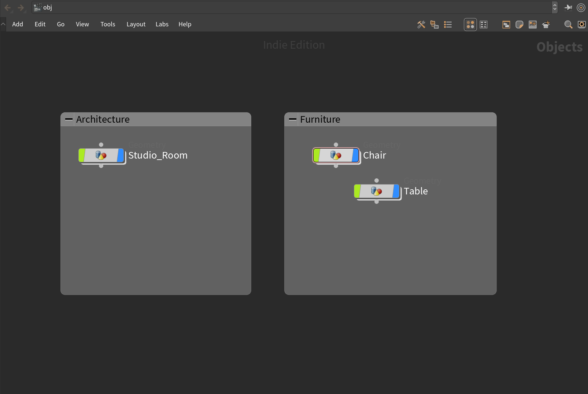
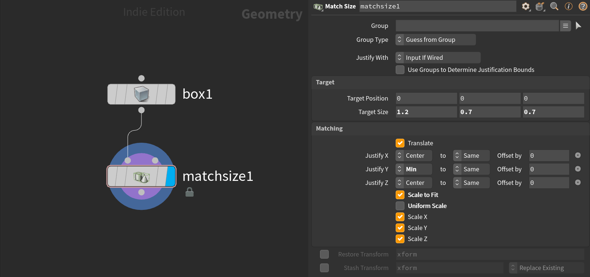
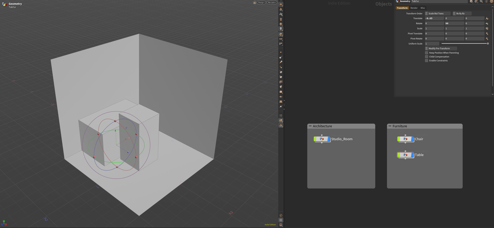
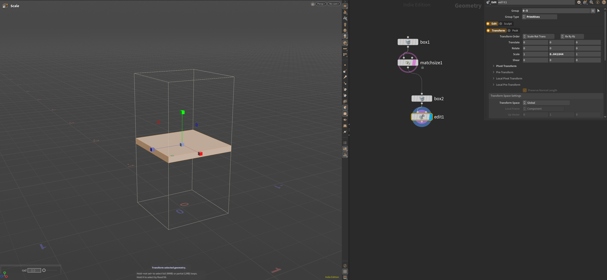
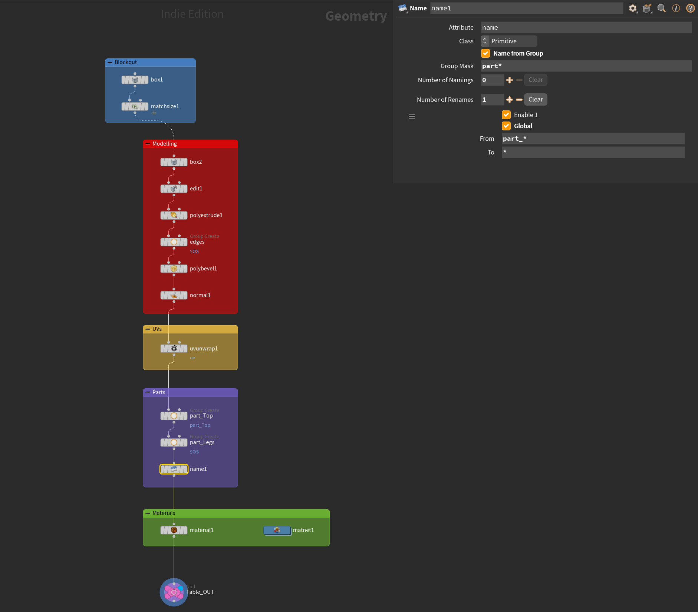
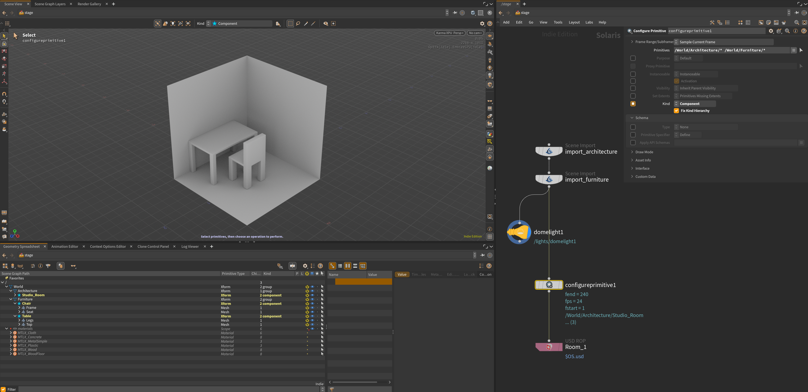
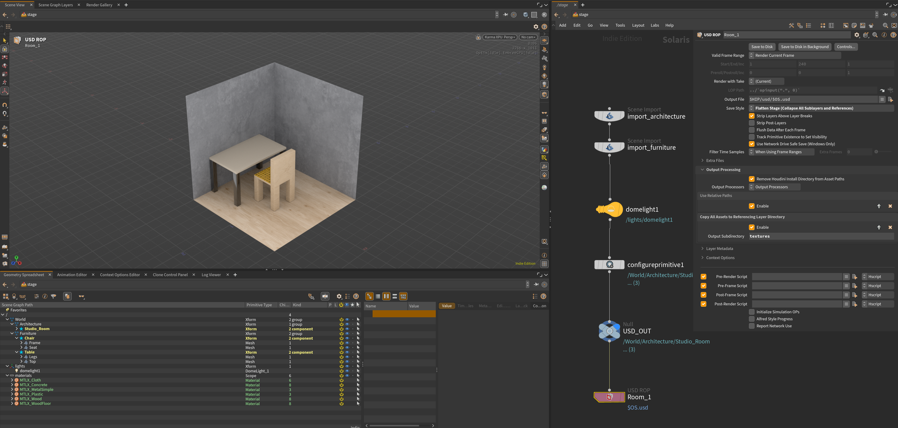

This guide outlines the workflow involved in creating an architectural scene. As an overview, we want to model in the OBJ context and apply MaterialX materials before importing the scene in Solaris and then exporting it as a single USD file into Unreal Engine. 

## Build (OBJ) Context
Starting from an empty scene in `obj` and then blocking out the architecture and objects before detailed modelling.  

### Scene Blockout
Begin by creating a few `box` geometry nodes and rename them to the objects we need. Add `network boxes` around these nodes and rename them. The network boxes essentially help visualise the different groups, in our case, `Architecture` and `Furniture`.   

To help organise the nodes position, select the nodes needing adjusting and hold `A` and drag down to arrange nodes evenly vertically or drag to the side for horizontal arrangement. 

Place a `Match Size` node below the box and make sure the `Justify Y` is set to `Min`. This restricts the object to always be placed on top the foor. The pivot also gets moved to this position. As we will be using this node set-up often, it's useful to `Save as Permanent Defaults` under the cog wheel so that when placed, it automatically lifts the target up.

These boxes will now become simplified shapes with the outer limits of the objects being placed. Use the `Target Size` on the node itself, rather than the Box dimensions. This will be helpful later on to provide a template in terms of size when modelling.  

Move and position the objects to their specific location in the scene. Importantly, this transformation should be done at the root OBJ level, where the `Geometry Node` sits. In this case, both the **Chair** and **Table** have been positioned in this way. The **Sudio_Room** has also been placed but with 3 basic polygons depicting the floor and walls. 

The reason we do it this way, is that when it comes to modelling those individual objects, they will be placed at the origin when the other objects get hidden, making it a lot easier to manage. The front of the object is always the **Blue Arrow**, so it is also important that this is the front of the model. The **Table** is facing towards the inside of the room, whereas the **Chair** is facing towards the table and wall. 

### Node Layout

Adding a box connected to the __matchsize1__ node, creates a box within that size. We can now begin modelling in the usual way, using the `Template` function (the pink highlight on the node) to show us the limits of the object. 

There are many ways to lay out the nodes required for a USD scene, but, below is a simple list of essential nodes for any 3D object: 

1. **Blockout** - Simple geo created with a _match size_ node
2. **Modelling** - Editing polygons and creating working groups before adding a bevel and then completing the model with a normal node 
3. **UVs** - Adding a UV Unwrap to allow for texture placement
4. **Parts** - Naming groups based on the materials being applied. It is important to note for USD scenes, the _Name_ node also helps title meshes in the scene graph. For this to be automatic, we can use _Name From Groups_ and in this case, filter out any group names that don't start with `part_`. This makes sure we use only the groups neccessary for our model. To clean the title, we can then use __Rename__ with _From_ set to `part_*` and _To_ set to `*`. This would result in a group named `part_Legs` being renamed to `Legs`. 
5. **Materials** - Linking created **MaterialX** materials in a _Material Network_ to the newly created named groups 

## Solaris (Stage) Context

Solaris is a look development and scene layout handler for USD scenes. While exporting USD files is possible from the obj context, there are many more features and options available in Solaris.

There are a few ways to import objects created in the obj context to the stage, but for this example we will be using the `Scene Import` node which, importantly, keeps the transformations made at obj level.  

Technically, having one node to import everything is possible, but to organise the _Scene Graph_ and when looking at the _Outliner_ in Unreal, it helps to organise the layers according to the groups we made from our **Network Boxes** earlier. In our case, we will select **Studio_Room** and set the _Destination Path_ to `/World/Architecture`. Do the same for both the chair and the table with `/World/Furniture` in a separate scene import node. Make sure `Import Materials` is enabled and use `Flatten Hierarchy` to make sure all materials get placed in the destination path: `/materials`. 

Add a dome light right after importing the scene to preview the scene using `Karma XPU` in the viewport. Check for missing objects, flipped normals, or missing materials.

Add a `Configure Primitive` node. This is required to fix the scene graph with the right **Kind** attributes to allow for collapsing meshes when imported into Unreal. Each object, with sub meshes, such as the _Table_: with _Legs_ and _Top_ will get merged into one mesh: SM_Table in Unreal. Point to the primitives `/World/Architecture` and `/World/Furniture` and enable `Kind` with `Component`. Also enable `Fix Kind Hierarchy`. 

The scene is ready to be exported. Add a `USD ROP` node and select an appropriate _output file_ path. We will be using the `Flatten Stage` _Save Style_ as this results in one USD file rather than many individual files. 

However, for the textures to be exported as well, we need to use `Output Processing`: Enable `Copy All Assets to Referencing Layer Directory` with a _Output Subdirectory_ of `textures`. This copies over the textures required by the materials to a folder named textures. 

When `Save to Disk` is clicked, it should result in one USD file being exported and a textures folder being created. The USD file contains all the architecture and furniture models while the  textures folder contains all images used by the materials. 

